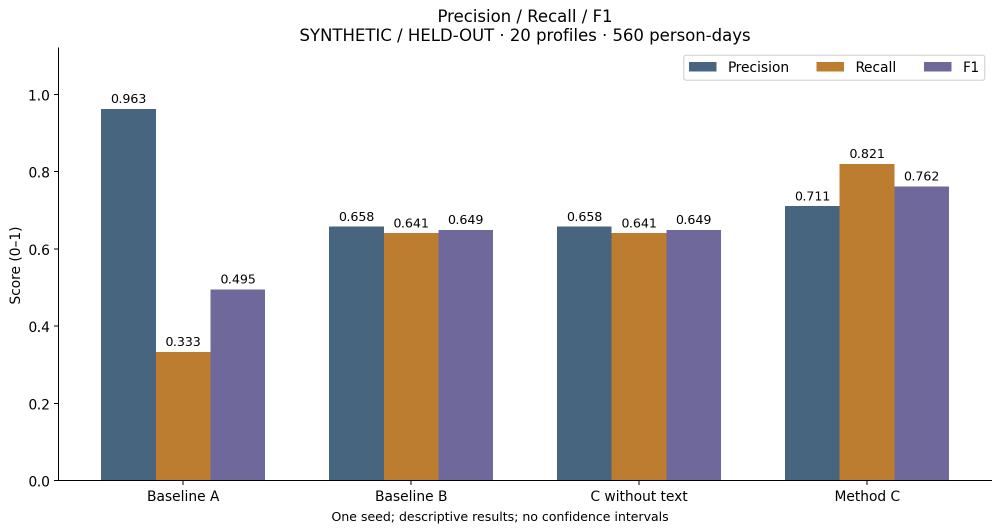
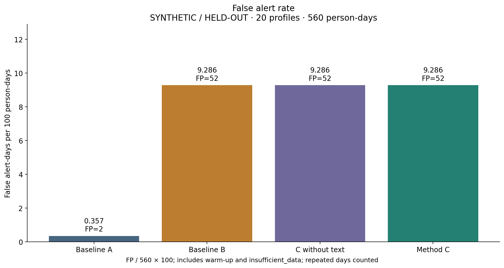
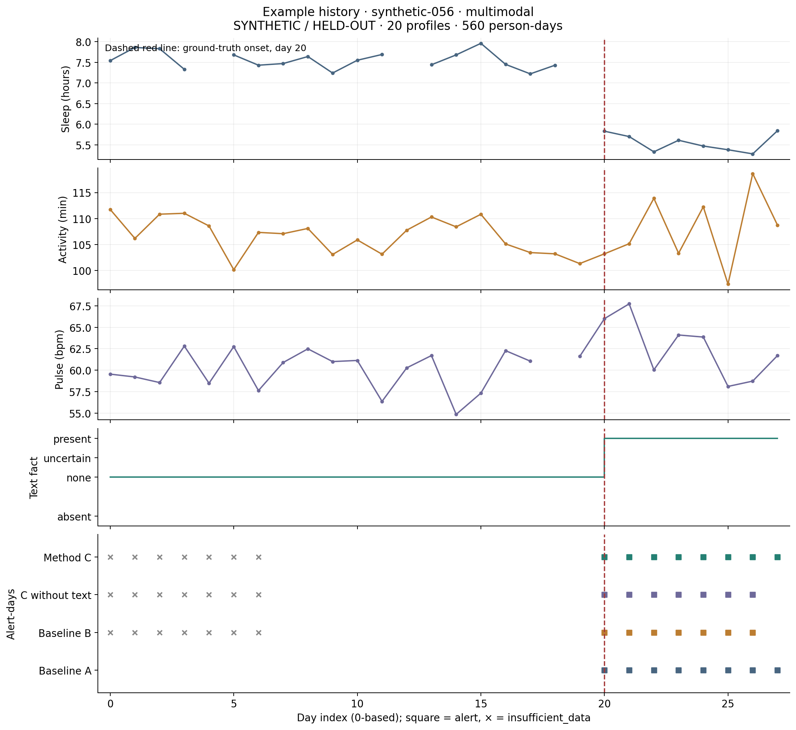

# Исследовательский раздел MEDSI Care: research-v2

Дата проверки: 10 ноября 2026 года. Все данные синтетические. Это описательный
инженерный эксперимент, а не клиническое исследование.

## Исследовательский вопрос и гипотеза

Помогает ли добавление извлечённых из текста сведений к персональной числовой
статистике обнаруживать заданные генератором изменения по сравнению с числовыми
методами? Гипотеза: текстовые сведения увеличат recall и F1 без роста количества
ложных дней срабатывания относительно Baseline B на этом синтетическом наборе.
Гипотеза не предполагает заранее установленного преимущества на реальных данных.

Инженерное предложение — прозрачное объединение персональной статистики,
валидированных текстовых фактов и явного статуса недостатка данных. Проверяемая
реализация — простое логическое OR числового и положительного текстового сигнала.
Это не реализация всех возможных весов PMAF из ТЗ и не медицинская модель.
Продуктовый monitoring и экспериментальный метод — отдельные реализации;
данная оценка не является клинической оценкой работающего приложения.

## Генерация данных и эталонная разметка

Генератор `experiments/synthetic.py` создаёт 100 профилей по 28 дней: всего
2800 человеко-дней. Seed генерации — 42. Для каждого профиля задаются случайные
исходные уровни сна, активности и пульса, независимый шум и сценарий. Пропуски
хранятся как `None`, а не заменяются нулями. Quality равен `good` при наличии
трёх измерений, иначе `questionable`; это характеристика полноты синтетической
записи, а не медицинская оценка точности измерительного прибора.

Сценарии генератора: стабильность, снижение сна, снижение активности,
мультимодальное изменение, только жалоба, изменение пульса, изменение с
пропусками, отрицание, неопределённость и текст при стабильных числах
(`discordant`). Начало изменения выбирается внутри второй половины истории.
После начала событие считается активным каждый последующий день до конца
истории. На профиль приходится максимум один эпизод; стабильный профиль не
имеет эпизода.

Скрытые поля `ground_truth_event`, `ground_truth_facts`, `scenario_type` и
`change_start_day` задаются спецификацией сценария, а не решениями методов.
Это независимость от проверяемого детектора, но не внешняя экспертная разметка:
генератор, шаблоны и правила написаны в одном проекте. Они задают упрощённую
исследовательскую задачу, а не фактическое состояние человека.

`DayRecord.observable()` формирует `MethodInput` без скрытых полей. Методы
принимают только этот тип; extractor получает только строку `check_in_text`.
Labels соединяются с предсказаниями по `(profile_id, day_index)` исключительно
в evaluator. В отчёте они сохранены для проверки расчётов, но не передаются
в API, UI, prompt или monitoring. В текущем генераторе отдельного
`corrected_text` нет: оценка проводится по `check_in_text` без симуляции ASR.

## Split и доступность истории

Детерминированное перемешивание profile IDs использует split seed 17113
(`42 + 17071`). В train — 80 профилей / 2240 дней; в test — 20 профилей /
560 дней. Пересечение profile IDs пустое. Train не используется для обучения
или выбора порогов. Настройки заморожены; по итогам этой проверки пороги,
генератор и split не изменялись.

Единица основной оценки — **один день одного профиля**, а не событие и не
профиль. В test 156 положительных и 404 отрицательных человеко-дня;
18 профилей имеют эпизод изменения, 2 стабильны. Начальные дни test-профиля
используются как его собственная причинно доступная история, а не как
train-примеры других профилей.

Baseline берёт только `rows[:index]`, то есть строго предыдущие дни того же
профиля, и последние 14 из них; текущий день в baseline не включается.
Проверены сортировка входа, совпадение предсказаний полного ряда и его префикса,
а также неизменность ранних решений при изменении будущих чисел и текстов.
Предиктор отклоняет повторные `(profile_id, day_index)`.

Разделение профилей не разделяет язык: в train 4 уникальных текста, в test 3,
все 3 текста test присутствуют в train. Новых текстовых шаблонов в test — 0.
В test представлены sleep_drop (3 профиля), pulse_change (5), discordant (1),
symptom_only (2), multimodal (4), negation (3), stable (2). Сценариев ambiguous,
activity_drop и missing_change в этой части нет. Обычные случайные пропуски
присутствуют, но особый сценарий missing_change отдельно здесь не оценён.
Split после выявления этого ограничения не менялся.

## Методы и extractor

- **Baseline A:** срабатывает при сне <6 часов, активности <30 минут или пульсе
  >100 bpm. При отсутствии всех чисел — `insufficient_data`. Это фиксированные
  экспериментальные правила, не клинические нормы.
- **Baseline B:** по каждому числу медиана и MAD предыдущих 14 дней, минимум
  7 непустых значений. Масштаб `1.4826 × MAD`; при нулевом MAD применяется
  `max(abs(median) × 0.05, 0.1)`. Любой доступный `abs(z) >= 2.5` даёт сигнал.
  При отсутствии доступных z-score — `insufficient_data`.
- **Method C:** если числовая база доступна, объединяет сигнал B с извлечённым
  фактом `weakness/present`. При недостатке числовой истории не выдаёт
  положительный результат даже при наличии текста. `absent` и `uncertain` не
  дают положительного текстового сигнала.
- **C без текста:** ровно B. Поэтому совпадение результатов с B — ожидаемая
  проверка абляции, а не независимое подтверждение гипотезы.

Quality/completeness используются как простой допуск: quality должен быть
`good` или `questionable`, хотя бы одно число должно присутствовать. Отдельной
обученной модели качества или весового объединения здесь нет.

Extractor `deterministic-ru-v1` — эвристика распознавания упоминания слабости,
отрицания и неопределённости с Pydantic-схемой результата. Он не клинически
обучен и не оценивает диагнозы. Воспроизводимый запуск не вызывает LLM;
необязательный LLM-адаптер не участвует в этих результатах.

## Определения метрик

TP/FP/FN/TN считаются на всех 560 днях test:

- TP: положительная метка и срабатывание;
- FP: отрицательная метка и срабатывание;
- FN: положительная метка без срабатывания;
- TN: отрицательная метка без срабатывания.

Precision = TP/(TP+FP), recall = TP/(TP+FN), F1 = 2PR/(P+R). При нулевом
знаменателе используется 0. Эти показатели безразмерны. Это micro-оценка по
дням; дни одного профиля коррелируют.

Ложные срабатывания на 100 человеко-дней = **FP/560 × 100**. Знаменатель —
все 20 × 28 дней test, включая положительные дни, начальную историю и
`insufficient_data`. Это не FP/404 и не доля ложноположительных решений среди
отрицательных дней. Каждый положительный день считается отдельным
срабатыванием: подавления повторов и объединения последовательных дней в одно
уведомление нет. Поэтому корректнее говорить «дни срабатывания», а не обещать
такое же число реальных notifications в приложении.

`insufficient_data` означает `attention=false`: день остаётся в матрице,
становится FN при положительной метке либо TN при отрицательной. Доля
недостаточных данных = их количество/560; такие дни не исключаются из оценки.

Detection latency измеряется **в днях**: индекс первого срабатывания после
начала эпизода минус эталонный индекс начала. Среднее рассчитывается только
среди обнаруженных эпизодов. Необнаруженные эпизоды не получают нулевую задержку
и не включаются в это среднее; их число показано отдельно. Срабатывания до
начала не засчитываются как обнаружение. Время ограничено 28-дневным окном,
оценка выживания и штраф за необнаруженный эпизод не рассчитываются.

Для extractor единица — пара `(category, polarity)` внутри конкретного
check-in; совпадения суммируются по всем test-записям. Точность границ evidence
не оценивается. Ошибки отрицания/неопределённости — записи с соответствующим
эталонным фактом, где нужная полярность не восстановлена.

## Фактические результаты

Архив: `experiments/artifacts/research-v2-seed42-2026-11-10/result.json`.
Проверенный коммит исходников: `859b69581327a0f22d7f8ae75605fb83356c1b3e`.
Протокол `research-v2`, схема отчёта `research-report-v2.1`, правила
`numeric-rules-v1`, extractor `deterministic-ru-v1`.

Количество случаев (человеко-дни):

| Метод | TP | FP | FN | TN |
| --- | ---: | ---: | ---: | ---: |
| Baseline A | 52 | 2 | 104 | 402 |
| Baseline B | 100 | 52 | 56 | 352 |
| C без текста | 100 | 52 | 56 | 352 |
| Method C | 128 | 52 | 28 | 352 |

| Метод | Precision | Recall | F1 | FP/560 × 100 | Средняя задержка, дни (обнаружено/18) | Пропущено эпизодов | Insufficient, дней |
| --- | ---: | ---: | ---: | ---: | ---: | ---: | ---: |
| Baseline A | 0.963 | 0.333 | 0.495 | 0.357 | 1.125 (8/18) | 10 | 0/560 |
| Baseline B | 0.658 | 0.641 | 0.649 | 9.286 | 0.118 (17/18) | 1 | 141/560 |
| C без текста | 0.658 | 0.641 | 0.649 | 9.286 | 0.118 (17/18) | 1 | 141/560 |
| Method C | 0.711 | 0.821 | 0.762 | 9.286 | 0.000 (18/18) | 0 | 141/560 |

Задержка A: 9/8 = 1.125 дня; B и C без текста: 2/17 ≈ 0.118 дня;
C: 0/18 = 0 дней. У B/C недостаточны 141/560 дней = 25.179%; у A — 0/560.

Extractor: TP=84, FP=0, FN=0 по парам фактов, P/R/F1=1.000.
Из 84 эталонных фактов 63 положительны, 21 отрицательный. Ошибки отрицания:
0/21. Неопределённые факты: 0 примеров; число ошибок 0, но **качество обработки
неопределённости на held-out наборе не оценено**. Отдельный unit-тест правила
для uncertainty не заменяет held-out оценку.

## Интерпретация и ограничения

В этом конкретном synthetic-наборе C имеет F1 0.762 против 0.649 у B
(разница ≈0.113); recall выше при том же FP=52. Это результат добавления
информативных шаблонных жалоб к числам. Он показывает поведение инженерной
реализации на заданном генераторе, но не доказывает мультимодальное улучшение
на реальных пользователях. Baseline A даёт существенно меньше FP, но пропускает
10/18 эпизодов; высокая precision A не делает его универсально лучшим.

Ограничения:

- Всего 20 тестовых профилей, один seed, описательная оценка. Доверительные
  интервалы пока не рассчитаны; статистическая устойчивость улучшения
  **не установлена**. Отсутствие power analysis не является объяснением или
  оправданием этого ограничения. Нельзя трактовать разницу F1 как статистически
  значимую. Для будущей оценки нужны дополнительные seed/сценарии и интервалы
  с учётом кластеризации по профилям; текущие дни не независимые пациенты.
- Текстовые шаблоны пересекаются между частями. F1 extractor=1 проверяет знакомые
  формулировки, а не обобщение русского языка или качество LLM.
- В test нет uncertain-фактов и некоторых типов сценариев; итоговые метрики
  не покрывают их качество.
- `discordant` означает положительную жалобу при стабильных числах; по
  конструкции это положительное событие. Здесь нет достаточной серии
  правдоподобных ложных жалоб, исторических упоминаний и сложных отрицаний.
- Разметка и тексты созданы одним генератором; они не независимая медицинская
  экспертиза. В этом наборе жалобы по построению информативны о событии.
- Задержка условна на обнаружении, а повторные дни считаются отдельно.
  Baseline адаптируется к изменённым прошлым наблюдениям — это причинное
  поведение, но оно может снижать recall длительного изменения.
- Evidence offsets, ASR, пользовательское подтверждение, ошибки сенсора,
  реальная клиническая чувствительность и нагрузка уведомлений не оценены.

Результаты допустимы в конкурсной работе только как описательный синтетический
инженерный эксперимент. Старые метрики Method C до устранения прямого
`symptom_present`-сигнала не публикуются. Нельзя заявлять клиническую
эффективность, безопасность медицинского применения или доказанное
превосходство на реальных людях.

## Графики и воспроизведение

Архив и исходные количества, записи, предсказания, извлечения и split сохранены
отдельно от `latest.json`. `--archive` требует чистый Git и запрещает перезапись.
Provenance содержит commit, SHA-256 Python-исходников, Python и Pydantic.
`figures/manifest.json` содержит хеш результата, хеши PNG/SVG и версию matplotlib.
Графики строятся только из JSON; методы при визуализации не запускаются.
В сохранённых SVG удалены хвостовые пробелы строк matplotlib для Git;
изображение не изменено. Повторяемость графиков числовая и визуальная,
а не побайтовая: SVG metadata/IDs могут отличаться. SHA256SUMS проверяет
целостность конкретного сохранённого архива.

```bash
.venv/bin/pip install -r experiments/requirements-plot.txt
.venv/bin/python -m experiments.verify_report \
  experiments/artifacts/research-v2-seed42-2026-11-10/result.json
.venv/bin/python -m experiments.run_experiment \
  --config-from experiments/artifacts/research-v2-seed42-2026-11-10/result.json \
  --output /tmp/medsi-research-replay.json
.venv/bin/python -m experiments.plot_results \
  --result experiments/artifacts/research-v2-seed42-2026-11-10/result.json \
  --output-dir /tmp/medsi-research-figures-new
```

Для точного состояния кода можно создать отдельный worktree от указанного
коммита и установить `backend[dev]` и `experiments/requirements-plot.txt`.
Проверка `verify_report` сравнивает SHA-256 и все данные/метрики с повторным
расчётом; если исходники изменились, следует использовать архивный коммит.
Повторная генерация графиков не перезаписывает существующую папку; PNG и SVG
публикуются в `figures/` рядом с JSON.







Временной пример — `synthetic-056`, первый по ID test-профиль типа multimodal,
а не выбранный по лучшему результату. Показаны сон, активность, пульс, извлечённый
текстовый факт, начало изменения на day_index=20 и все дни срабатываний методов.
Разрывы линий — пропуски, серые кресты — недостаток данных.
